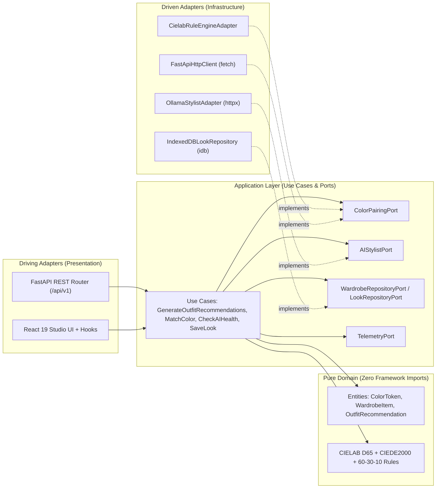

# Architecture Guide — Strict Hexagonal Architecture (Ports & Adapters)

Atelier Pal (`v0.0.1`) enforces **strict inward dependency rules** across both the Python FastAPI backend and the React TypeScript frontend.

## 1. Hexagonal Architecture Diagram

## 2. Strict Dependency Rules

1. **`domain/` (Innermost Core):**
   - Contains pure entities, value objects, enums, domain exceptions, CIELAB math, and deterministic 60-30-10 styling rules.
   - **Zero** imports from `application/`, `infrastructure/`, `presentation/`, or external frameworks (`fastapi`, `pydantic`, `httpx`, `react`, `idb`).
   - Enforced automatically by `backend/tests/test_architecture.py` (AST inspection) and `frontend/src/__tests__/architecture.test.ts`.
2. **`application/`:**
   - Defines Use Cases, Input/Output DTOs, and abstract **Ports** (`ABC` in Python, `interface` in TypeScript).
   - May import from `domain/` only. Never imports `infrastructure/` or `presentation/`.
3. **`infrastructure/` (Driven Adapters & Mappers):**
   - Implements Application Ports (`CielabRuleEngineAdapter`, `OllamaStylistAdapter`, `IndexedDBLookRepository`, `FastApiHttpClient`).
   - Houses explicit **Domain ↔ DTO/Schema Mappers** (`backend/app/infrastructure/mappers.py`) so API serialization changes never leak into domain models.
4. **`presentation/` (Driving Adapters):**
   - FastAPI routers & Pydantic schemas on the backend; React components & ViewModel hooks (`useStylingStudio.ts`) on the frontend.

---

## 3. Recipes for Adding New Adapters

### Recipe A: Swapping IndexedDB for Cloud Sync (v0.0.2+)
1. Create `frontend/src/infrastructure/api/CloudLookRepository.ts` implementing `LookRepositoryPort` (`listLooks`, `saveLook`, `deleteLook`).
2. Optionally compose an `OfflineFirstLookRepository` that writes to `IndexedDBLookRepository` immediately and syncs to the cloud API in the background.
3. Swap the repository instance in `useStylingStudio.ts` — `LookStorageUseCases` and all UI components remain untouched.

### Recipe B: Adding a Vision Model Adapter for Garment Photo Extraction (v0.0.3)
1. Define `GarmentExtractionPort` in `backend/app/application/ports.py` with `extract_garment(image_bytes: bytes) -> WardrobeItem`.
2. Implement `OllamaVisionAdapter` (e.g., `llama3.2-vision` or `llava`) in `backend/app/infrastructure/ollama_vision.py`.
3. Use `find_nearest_color_token()` from `app/domain/color_math.py` to snap the extracted dominant garment color to a `ColorToken`.
4. Wire the new use case in `backend/app/presentation/dependencies.py` and expose `POST /api/v1/vision/extract-garment`.

### Recipe C: Connecting a React Native / Flutter Mobile Client (v0.1.0)
1. Mobile clients consume the exact same `/api/v1/...` REST endpoints (`colors`, `colors/match`, `recommendations/computed`, `recommendations/ai`, `recommendations/dual-track`).
2. Zero color math or prompt engineering is duplicated on mobile; only the `presentation/` and local storage adapter (e.g., SQLite/AsyncStorage implementing `LookRepositoryPort`) are mobile-specific.
