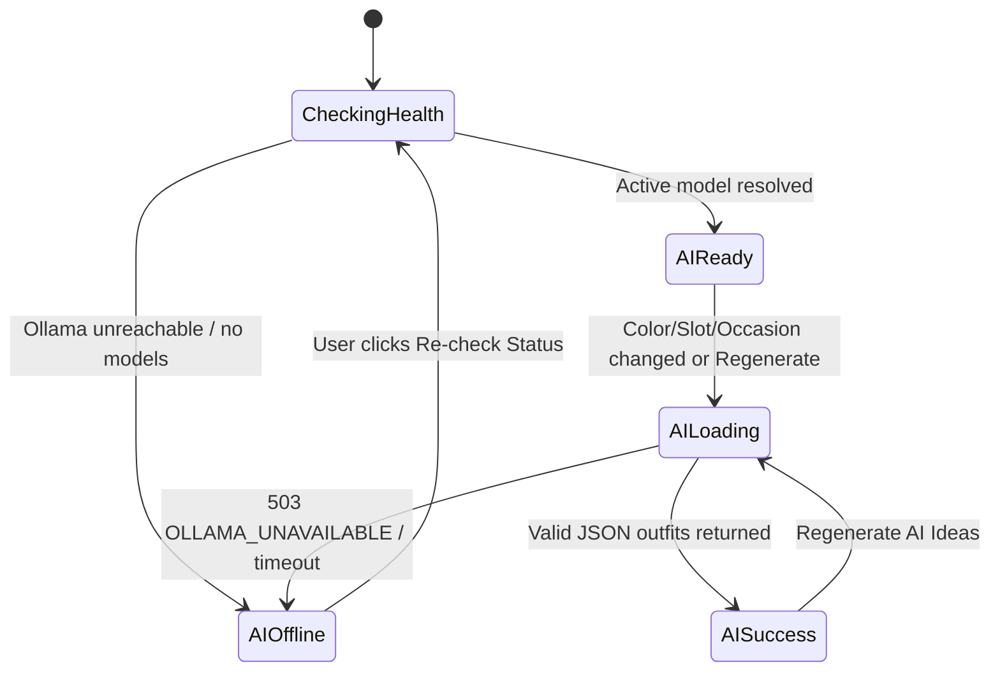

# UI & Functional Specifications

## 1. Functional Requirements & User Flows (`v0.0.1`)

1. **Base Piece & Color Selection:**
   - Users select from 30 realistic wardrobe colors grouped into **Core Neutrals (12)** and **Statement & Accent Colors (18)**.
   - Users can pick or type any custom Hex color and click **Snap** to match it to the nearest perceptual `ColorToken` via CIEDE2000 ($\Delta E_{2000}$), displaying the exact $\Delta E$ distance.
   - Users choose a **Garment Slot** (`Top`, `Bottom`, `Outerwear`, `Footwear`) and **Occasion / Vibe** (`Casual`, `Smart Casual`, `Office`, `Date Night`).

2. **Dual-Track Recommendation Display:**
   - **Track A (Computed Color Math):** Renders immediately with 4 strategies (*Safe & Everyday*, *Monochromatic / Tonal*, *Balanced Contrast*, *Editorial / Seasonal*) and a 60-30-10 visual proportion bar.
   - **Track B (Independent AI Stylist):** Loads asynchronously with a skeleton loader. Users can click **Regenerate AI Ideas** to request fresh combinations.
   - **Source Filter Bar:** `All Engines`, `Computed (Math)`, and `AI Generated` tabs allow side-by-side comparison or isolated inspection.

3. **Lock & Remix + Saved Looks:**
   - Users can lock individual garment slots on Computed cards and click **Remix Computed** to cycle remaining slots deterministically.
   - Clicking **Save** persists the look to IndexedDB (`fashion-pal-db`) with full `source` provenance (`math_engine` vs. `ollama_ai`) visible in the **Saved Looks Drawer**.

---

## 2. State Machine (AI Track & Graceful Degradation)

- **Invariant:** Track A (Computed) never blocks on Track B (AI). If Track B enters `AIOffline`, Track A remains 100% interactive and an actionable setup banner (`ollama pull llama3.2`) is shown.

---

## 3. Provenance Badge Rules

Every outfit card and saved look MUST clearly distinguish its origin:
- **Computed (`source === "math_engine"`):** Sky-blue badge (`bg-sky-100 text-sky-900`) with calculator icon: `Computed · Color Math`.
- **AI Generated (`source === "ollama_ai"`):** Violet badge (`bg-violet-100 text-violet-900`) with sparkles icon: `AI Stylist · <active_model>`.

---

## 4. IndexedDB Schema Versioning Strategy

- **Database:** `fashion-pal-db`
- **Version 1 (`v0.0.1`):**
  - Object Store: `saved_looks` (`keyPath: 'id'`, index `'by-saved-at'` on `'saved_at'`).
- **Version 2 (`v0.0.2` planned):**
  - Add `wardrobe_items` (`keyPath: 'id'`, index `'by-slot'`) and `garment_blobs` (`keyPath: 'id'`) to store local garment photos without hitting `localStorage` size limits.

---

## 5. Phased Feature Matrix

| Phase | Target | Key Capabilities |
| :--- | :--- | :--- |
| **`v0.0.1`** | **Color Studio MVP (Current)** | Hexagonal architecture, 30-color CIELAB palette, 60-30-10 math engine, Ollama structured-output AI stylist, Lock & Remix, IndexedDB Saved Looks. |
| **`v0.0.2`** | **Digital Closet** | Enable `My Closet` tab, IndexedDB `wardrobe_items` + photo blobs, outfit matching against owned garments. |
| **`v0.0.3`** | **Vision Extraction** | `OllamaVisionAdapter` (`llama3.2-vision`), automatic garment slot & CIELAB color extraction from uploaded photos. |
| **`v0.1.0`** | **Mobile Companion** | React Native / Flutter client consuming `/api/v1`, weather-aware `Outfit Planner`, and `Style Profile` preferences. |
